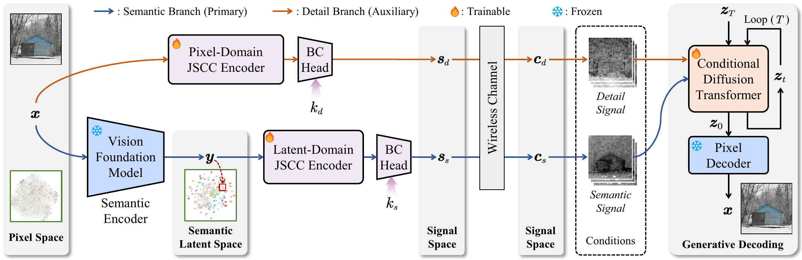
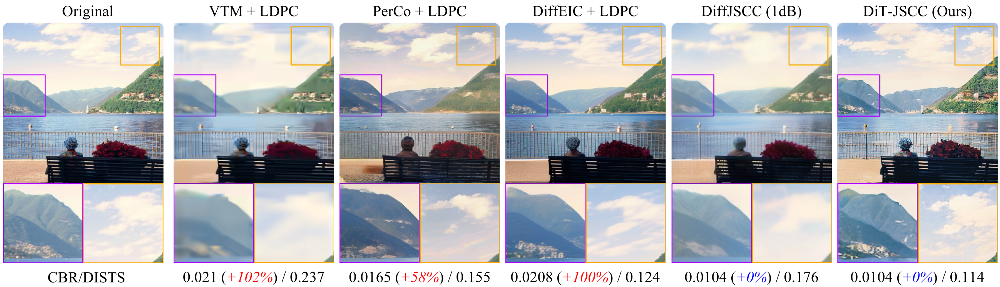
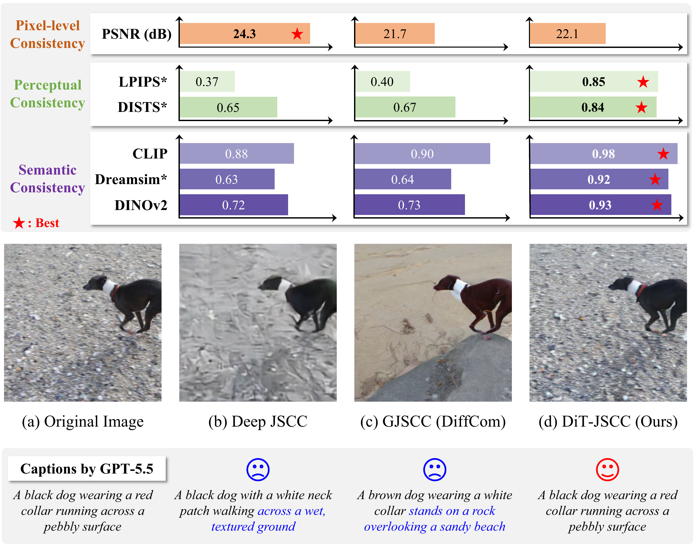
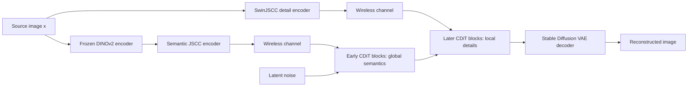

<div align="center">

# DiT-JSCC

### Rethinking Deep JSCC with Diffusion Transformers and Semantic Representations

[](https://www.python.org/)
[](https://pytorch.org/)
[](app.py)
[](LICENSE)

[Web Demo](#interactive-web-demo) · [Inference Guide](docs/INFERENCE.md) · [中文](README_zh-CN.md)

**Official PyTorch inference toolkit for semantics-prioritized generative joint source-channel coding.**

</div>



## Overview

Generative JSCC can synthesize realistic images at extremely low bandwidth, but realism alone does not guarantee that the received image preserves the meaning of the source. DiT-JSCC addresses this mismatch by co-designing what the transmitter sends and how the generative receiver uses it.

The transmitter decomposes an image into complementary **semantic** and **detail** representations. A wireless channel corrupts both signals, and a conditional diffusion transformer reconstructs the image from coarse to fine: high-level DINOv2 features stabilize global content in early blocks, while SwinJSCC detail features refine local texture and edges in later blocks.

### Why DiT-JSCC?

- **Semantics-prioritized transmission.** A VFM-driven branch explicitly preserves objects, layout, and global structure under scarce channel resources.
- **Coarse-to-fine conditional DiT.** Multi-level conditions enter different decoder depths instead of being fused through a single generic adapter.
- **Flexible bandwidth.** Semantic and detail channel dimensions can be controlled independently at inference time.
- **Content-adaptive allocation.** The paper introduces a training-free strategy inspired by Kolmogorov complexity to estimate semantic bandwidth demand.
- **Extreme-channel robustness.** The method targets CBRs from 1/384 to 1/48 and low-SNR AWGN/Rayleigh regimes.

## Qualitative results



At 512 × 512 and 0 dB AWGN, DiT-JSCC preserves global geometry and fine structures while using a smaller CBR or lower SNR than the compared methods in the paper. The figure above is exported directly from the manuscript.



The project evaluates three complementary dimensions rather than relying on PSNR alone:

| Dimension | Metrics | What it measures |
|---|---|---|
| Perceptual consistency | LPIPS, DISTS | Local structure and texture agreement |
| Semantic consistency | CLIP, DreamSim, DINOv2 | High-level content and conceptual fidelity |
| Realism | FID | Distributional similarity to natural images |

On the paper's 256 × 256 ImageNet subset at CBR = 1/48 and 0 dB AWGN, DiT-JSCC reports **0.166 LPIPS**, **0.963 CLIP**, **0.958 DINOv2**, and **60 FID**. See the paper for the complete protocol, baselines, confidence considerations, and Rayleigh results.

## Quick start

### 1. Create the environment

An NVIDIA GPU is strongly recommended. The 512 × 512 model has a substantially larger memory footprint.

```bash
git clone https://github.com/semcomm/DiTJSCC.git
cd DiTJSCC

conda create -n ditjscc python=3.10 -y
conda activate ditjscc

# Install the PyTorch build matching your CUDA version first:
# https://pytorch.org/get-started/locally/
pip install -e .
```

### 2. Add checkpoints

No model weights are included in this repository. When checkpoints become
available, place them in the pre-created directory using this layout:

```text
checkpoints/
├── autoencoder_kl.pth
├── dit_jscc_256.pth
└── dit_jscc_512.pth
```

The DINOv2 ViT-B/14 weights are downloaded by `torch.hub` on first use. For an offline installation, set `DINOV2_REPO` to a local clone of the official DINOv2 repository. Exact file expectations and validation commands are documented in [checkpoints/README.md](checkpoints/README.md).

Check the installation without allocating the model:

```bash
python infer.py --check --resolution 256
```

### 3. Run inference

```bash
python infer.py \
  --input examples/example_input.png \
  --output outputs/demo \
  --resolution 256 \
  --channel awgn \
  --snr 0 \
  --semantic-rate 8 \
  --detail-rate 8 \
  --sampler dpm_solver \
  --steps 20 \
  --seed 1000
```

Pass a directory to `--input` for batch inference. Each run writes reconstructed PNGs and a `metadata.json` file containing all channel and sampling settings.

## Interactive Web Demo

Launch the local Studio:

```bash
python app.py
```

Open `http://127.0.0.1:7860`. The interface supports:

- 256 × 256 and 512 × 512 checkpoints;
- AWGN and Rayleigh channel simulation;
- SNR control from -10 dB to 20 dB;
- independent semantic/detail bandwidth selection;
- DPM-Solver, Euler ODE, and the paper's Euler SDE sampler;
- deterministic seeds, guidance scale, and sampling-step control;
- exact CBR and runtime metadata for every reconstruction.

The paper trains separate checkpoints for each channel/SNR condition. The UI
changes the simulated test channel; paper-level reproduction requires loading
the checkpoint trained for the corresponding condition.

<details>
<summary><b>Launch on a remote server</b></summary>

```bash
GRADIO_SERVER_NAME=0.0.0.0 GRADIO_SERVER_PORT=7860 python app.py
```

Set `GRADIO_SHARE=1` only when you intentionally want Gradio to create a public share link.

</details>

## Python API

```python
from PIL import Image
from dit_jscc import DiTJSCCPipeline

pipe = DiTJSCCPipeline(resolution=256, device="cuda", precision="fp16")
result = pipe(
    Image.open("examples/example_input.png"),
    channel_type="awgn",
    snr_db=0,
    semantic_rate=8,
    detail_rate=8,       # total rate gives CBR = 1/96 at 256 px
    sampler="dpm_solver",
    steps=20,
    guidance_scale=2.0,
    seed=1000,
)
result.image.save("reconstruction.png")
print(result.metadata())
```

See [docs/INFERENCE.md](docs/INFERENCE.md) for parameter semantics, supported rates, preprocessing, reproducibility, and troubleshooting.

The lightweight `dit_jscc.bandwidth` module also implements the paper's
KC-inspired caption complexity and rate-allocation equation. It accepts
dataset normalization statistics explicitly, keeping BLIP-2 optional and the
interactive demo transparent.

## Method at a glance



The channel bandwidth ratio is

$$\rho = \frac{k}{3HW},$$

where $k$ is the number of complex channel symbols and $H \times W$ is the source resolution. In the public wrapper, both transmitted branches use a 16 × 16 token grid, and pairs of real values form complex symbols.

## Repository layout

```text
DiTJSCC/
├── app.py                    # Gradio Studio
├── infer.py                  # convenient CLI entry point
├── dit_jscc/                 # stable public inference API
├── inference_core/           # minimal checkpoint-compatible model code
├── configs/                  # clean 256/512 inference configurations
├── checkpoints/              # local model files (Git LFS ignored)
├── examples/                 # sample inputs
├── docs/                     # inference guide and README assets
└── tests/                    # lightweight public API tests
```

This is a self-contained inference release. The complete research workspace,
training scripts, manuscript source, and local experiment artifacts are
intentionally kept outside this repository.

## Training and evaluation

The paper trains on ImageNet at 256 × 256 and 512 × 512. The DiT decoder contains 21 DiT/CDiT blocks, uses a hidden size of 1024 and 16 attention heads, and is initialized from a pretrained class-conditional diffusion transformer.

This public repository is intended for checkpoint inference. Training code and
the private/local evaluation workspace are not bundled. Reproducing paper
tables additionally requires the ImageNet evaluation subset and
metric-specific dependencies described in the manuscript.

## Citation

If this project is useful in your research, please cite:

```bibtex
@misc{tan2025ditjscc,
  title   = {DiT-JSCC: Rethinking Deep JSCC with Diffusion Transformers and Semantic Representations},
  author  = {Tan, Kailin and Dai, Jincheng and Wang, Sixian and Lu, Guo and Shao, Shuo and Niu, Kai and Zhang, Wenjun and Zhang, Ping},
  year    = {2025},
  note    = {Manuscript},
  url     = {https://github.com/semcomm/DiTJSCC}
}
```

## Acknowledgements

This implementation builds on ideas and components from DINOv2, SwinJSCC, U-ViT/DiT, DPM-Solver, and the Stable Diffusion autoencoder. We thank the respective authors for making their work available to the community.

## License

Released under the [Apache License 2.0](LICENSE). Third-party models, datasets, and pretrained weights remain subject to their original licenses and terms.
